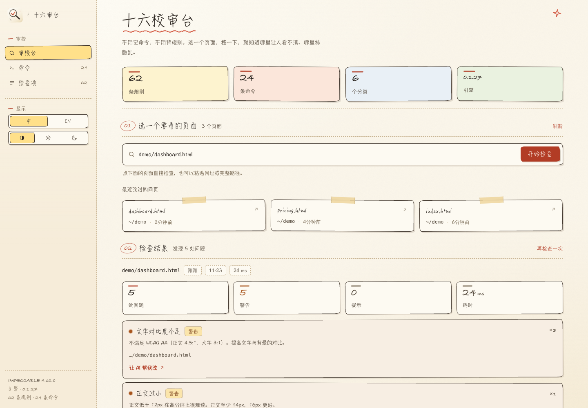
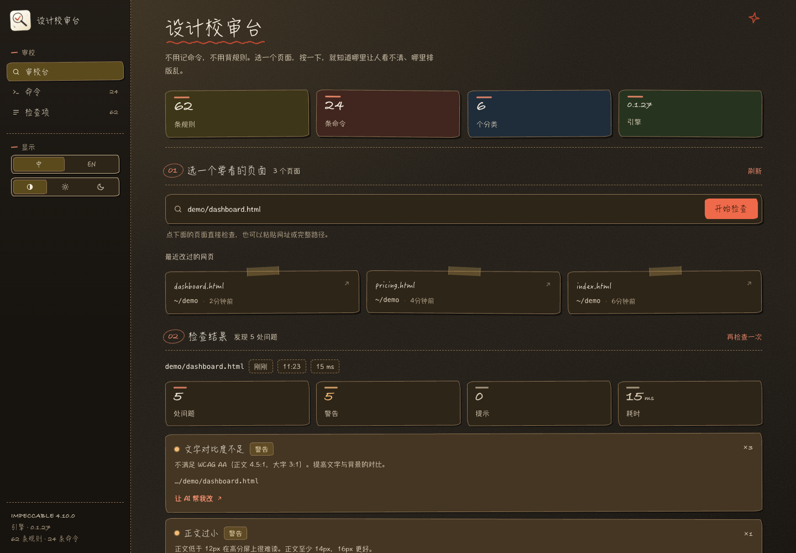

# dsh-impeccable

Design review desk for DeepSeek Harness. Brings [impeccable](https://github.com/pbakaus/impeccable)'s design vocabulary into the sidebar: 24 commands, 62 deterministic detectors, and a one-click scan of the interface in front of you. The panel is drawn by hand on paper — a warm sheet in the light theme, kraft paper in the dark one.

The **设计校审台** mark appears in the sidebar; clicking it opens the review desk with four numbered sections.

- **Pick a page** — the field sits at the top: filter the HTML files you edited recently, or paste a path or URL. Click a card to select it; the arrow on the card checks that page directly.
- **Result** — findings grouped by problem, in plain language, with file and line; locations in the same file share one line (up to three line numbers), and a **Have AI fix it** link opens a session with the file, the problem and the skill path. The section scrolls itself into view when a check finishes.
- **Commands** — the 24 commands (`critique`, `audit`, `polish`, `typeset`, `live`, …). Clicking a card copies its prompt; the arrow in the corner starts a new conversation with that prompt instead. The prompt points the agent at the skill docs so it can read `SKILL.md` and `reference/<command>.md` before acting.
- **Rules** — the 62 rules, searchable, with id, category and description. Collapsed by default.

## Screenshots

| Light | Dark |
| --- | --- |
|  |  |

## Nothing to install by hand

The skill ships inside this package (`skill/`, version 4.10.0 — 24 commands, 62 rules, 47 reference docs). Installing the plugin is enough.

The only thing that arrives later is the detection engine, a ~21 MB native binary:

| What | Where | When |
| --- | --- | --- |
| Skill | `skill/` in this package | shipped with the plugin |
| Engine | `~/.impeccable/bin/<version>/impeccable` | downloaded in the background on first load |

On load the host side starts the bundled launcher (`skill/scripts/impeccable`) once in the background, so the binary is usually there before you click Scan. If a scan happens first, that scan downloads it and may take a minute. The engine is looked up in this order: `IMPECCABLE_BIN`, the highest version under `~/.impeccable/bin`, then the bundled launcher.

If you already ran `npx impeccable install --providers=dsh --scope=global` before, `~/.dsh/skills/impeccable` takes precedence over the bundled copy — so an upgrade you installed yourself is never shadowed by an older one.

The plugin itself never calls the network. Only the engine download does, and only once.

## Bilingual by default

Every command and every rule carries a Chinese name and description, so the panel reads as one language instead of half English. Chinese is the default when the app language is Chinese, but the rail footer carries a **中 / EN** switch that overrides the app language and remembers the choice; wherever a translation is missing the panel falls back to the English original instead of showing an empty line, and the rule search matches both languages at once.

## Visual language

The panel is drawn on paper, not set like a settings form.

- **Light** is a warm sheet: `#fbf6ea` ground with a grain texture and darker paper edges, charcoal ink for outlines, vermilion for links, section numbers and the primary button, highlighter yellow for the selected rail item and filter chip. Section numbers sit inside hand-drawn circles; headings are handwritten with a wobbling vermilion underline; counts, ids and versions use a handwriting numeral face (Bradley Hand, Chalkboard SE); body copy uses a pen-handwriting face where one is installed and falls back to the system sans where it is not, so the small print stays legible.
- **Dark** is the same drawing on kraft paper: `#1d1811` ground, cream chalk lines, salmon vermilion, dimmed mustard marker, and the sticky notes drop to olive, oxblood, slate and moss.
- **Made of paper, not chrome**: cards are stickers — 1.5–2px ink outlines with irregular corner radii, a hard 2–3px offset shadow, sub-degree rotations that straighten on hover, a strip of washi tape across the recently edited pages; each sticky note has one short red rule along its top; separators are dashed and the focus ring is dashed vermilion. The mark and the app icon (a hand-drawn magnifier with a vermilion brush tick) come from the same pen, drawn as an SVG in `docs/design/icon.svg` and rendered to `icon.png`.

Everything lives in the panel's own `--im-*` tokens inside one `<style>` string in `lib/client.js`; nothing is fetched over the network. **Auto** follows the DSH theme attribute, **Light** and **Dark** pin it, and the choice survives reloads. The rail is a narrow column holding the mark, the three anchors and the display controls at its foot; below 900px it folds into a top bar and the content goes single column at 560px. Reading text stays at 12px or larger (small labels were raised from 11px), and the only motion is a skeleton shimmer and a progress bar that breathes in place.

## Three steps, no vocabulary

The panel is written for someone who has never opened a design tool. There is nothing to type and no command to remember:

1. **Pick a page.** The field at the top lists the HTML files you edited recently on this machine; type to filter, click a card, or press the arrow on it to check it right away. Only if nothing turns up do you paste a path or URL.
2. **Press one button.** "Check page" runs all 62 rules against it and the result section appears below.
3. **Read what is wrong.** Findings are grouped by problem, in plain Chinese ("文字对比度不足"), with the file and line, and every group carries a **Have AI fix it** link that opens a session preloaded with the file, the problem and the skill path.

The 24 commands and the 62-rule catalog are still there, but folded away under *More tools* and *What it checks* — a beginner never has to scroll past them, and the command cards lead with a Chinese action ("挑毛病") with the real command name as a footnote.

## Checked against its own rules

This panel is scanned by the same 62 rules it exposes. The first pass found 66 problems in it: it opened with a tracked uppercase kicker above the heading (banned outright), its scanning bar was an infinite horizontal marquee (banned), and 62 runs of text sat under the 11px legibility floor. Those are gone, and the hand-drawn skin was scanned the same way. A flat light render returns two notes, both deliberate: `cream-palette` (the warm paper ground) and `repeating-stripes-gradient` (the washi tape and the dashed progress track) — a paper skin without cream is not a paper skin. In the dark scheme one more note appears, `cramped-padding` on the panel root: the panel is full-bleed by design, so the rail and the content sit flush against it. Contrast, legibility, all-caps and marquee come back clean. With the command and rule lists expanded the only extra note is a rule description quoting the buzzwords it warns about.

## Install

```bash
dsh plugin add dsh-impeccable-studio
```

From a checkout, `dsh plugin add ./plugins/dsh-impeccable` (or **Install local plugin** in the plugin panel) works too. Restart DeepSeek Harness afterwards: the host reads the bundle list at startup.

## Uninstall

```bash
dsh plugin remove dsh-impeccable-studio
```

## How it works

- `lib/index.js` — host side. Registers three routes under `/impeccable/api/*` (`targets`, `catalog`, `detect`), resolves the skill and the engine, runs the CLI and returns JSON. Each detection runs with a 180s timeout (10min while the engine is still downloading), a 64MB buffer and at most 600 findings returned.
- `lib/client.js` — browser side. Registers `sidebar.panellist` (order 15) and `main` (`key: impeccable`). The hand-drawn skin is one `STYLE` template string at the bottom of that file — presentation only, no DOM changes.
- `skill/` — the bundled skill: `SKILL.md`, 24 command rows, 47 reference docs, the launcher and its data files.
- `lib/zh.js` — Chinese names and descriptions for the 24 commands, 6 categories and all 62 rules, applied on the host side when building the catalog.
- `locale/` — title and description shown in the plugin list.
- The panel carries its own `--im-*` tokens for both schemes (paper ground, ink lines, vermilion accent, marker yellow, sticky-note tints, tape and hard-shadow colours); **Auto** reads the host theme attribute, **Light** / **Dark** override it.
- `docs/design/icon.svg` — the hand-drawn mark; `icon.png` is the rendered 512px tile with transparent corners.

`impeccable detect` exits with code 2 when there are findings while still printing the full JSON report; the host side reads it from `error.stdout` and treats it as a result, not a failure.

---

## 中文

把 [impeccable](https://github.com/pbakaus/impeccable) 的设计审校能力搬进 DeepSeek Harness 左侧面板。面板画在纸上：浅色是暖白纸，深色是牛皮纸。

左侧栏多一个放大镜图标，点开是「设计校审台」，四个编号区块：

- **选页面** — 输入框在最上面：筛选最近改过的 HTML，或粘贴路径 / 网址。点卡片选中，点卡片右上角箭头直接检查
- **看结果** — 问题按类型分组，写清文件和行号，每组最多列三处，带「让 AI 帮我改」链接；检查完成后这一块会自动滚进视野
- **命令** — 24 条命令（critique / audit / polish / typeset / live …），点一下复制提示词，点卡片右上角箭头直接开新对话；提示词会带上技能文档路径，agent 先读 `SKILL.md` 的 Setup 再执行
- **规则目录** — 62 条规则可搜索，看 id、分类、说明

**中英双语**：左栏底部有「中 / EN」开关，可以覆盖应用语言并记住选择；24 条命令和 62 条规则的名称、说明都有中文，缺译处回落到英文原文，规则搜索中英双匹配。

**明暗两套**：左栏底部「自动 / 浅色 / 深色」三档。自动跟随 DSH 当前主题，浅色和深色把面板锁成暖白纸或牛皮纸；两套配色都写在面板自己的 `--im-*` 变量里，与宿主主题解耦，刷新后保留选择。

**手绘纸皮肤**：纸面带纸纹和边缘暗角，边框是不规则圆角加硬阴影；标题用翩翩体（HanziPen SC），正文用手写体（手札体 / 翩翩体 / 楷体，装不到就退回系统字，保证小字清晰），数字和编号交给 Bradley Hand；分节号外面一圈手绘椭圆，标题下是一条朱红波浪线，四格数字是米黄 / 淡粉 / 淡蓝 / 淡绿的便签、各配一条红短横线，最近改过的页面像贴纸一样顶上贴一条和纸胶带、悬停抬起回正；分隔线和焦点框都是虚线。图标也是一支笔画出来的手绘放大镜（朱砂勾），源文件在 `docs/design/icon.svg`，`icon.png` 由它导出。

左栏是一列窄导航，900px 以下折成顶栏，560px 以下单列。正文不小于 12px（原来 11px 的小标签都提上来了），动效只保留骨架微光和一条会呼吸的虚线进度条。

**自查**：这套皮肤会被自己的规则扫出两条 —— `cream-palette`（暖纸底）和 `repeating-stripes-gradient`（胶带和进度虚线），都是有意的；深色下还会多一条 `cramped-padding`，说的是面板铺满整个容器、左右两侧不留白 —— 面板本来就是满幅的。对比度、字号、全大写、跑马灯这类问题一条没有。

**不用手动装技能**：技能（4.10.0，24 命令 / 62 规则 / 47 篇参考文档）已经打包在插件的 `skill/` 目录里，装插件即用。

唯一后到的是检测引擎（约 21 MB 的原生二进制）：插件加载时会在后台用自带的启动器下载一次，通常你点扫描之前就已经好了；如果没好，那次扫描会边下边跑，多等一分钟。查找顺序是 `IMPECCABLE_BIN` → `~/.impeccable/bin` 下最高版本 → 包内启动器。

之前自己跑过 `npx impeccable install --providers=dsh --scope=global` 的话，`~/.dsh/skills/impeccable` 优先于包内副本，自己升级的版本不会被旧版盖住。

```bash
dsh plugin add dsh-impeccable-studio     # 安装
dsh plugin remove dsh-impeccable-studio  # 卸载
```

装完重启 DeepSeek Harness 生效。插件本身不走网络，只有引擎下载需要联网。
